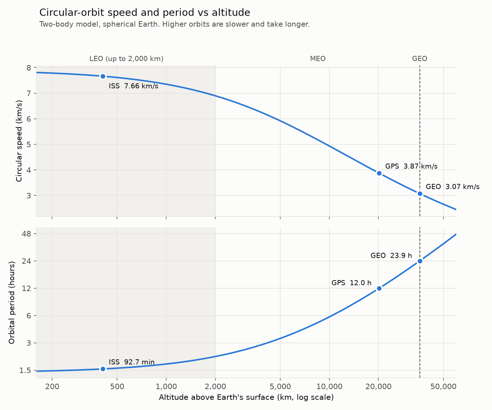

# orbital-mechanics-calculator

A Python toolkit that classifies satellite orbits, computes circular-orbit speed and period, parses a list of satellites from a text file, and models any elliptical two-body orbit (energy, angular momentum, vis-viva speeds). Every result is checked by a pytest suite of 70 tests against hand calculations, conservation laws and invalid inputs.

## What it does

1. Classifies a satellite's orbit (LEO, MEO, GEO or Beyond GEO) from its altitude.
2. Computes the orbital radius, circular-orbit speed, and circular-orbit period for any altitude.
3. Reads a list of satellites from a plain-text file, computes orbit values for each valid satellite, and saves the results as CSV and JSON.
4. Models an elliptical orbit from its semi-major axis and eccentricity: periapsis and apoapsis, period, specific energy, angular momentum, and speed at any radius.

## Repository structure

```
orbital-mechanics-calculator/
├── calculator.py              classification, radius, circular speed and period
├── parse_satellites.py        satellite file parser, CSV/JSON output
├── orbit_class.py             Orbit class for elliptical two-body orbits
├── plots.py                   speed and period vs altitude figure
├── pytest.ini                 pytest configuration
├── data/
│   └── satellites.txt         input: 10 satellites plus 4 deliberately bad lines
├── output/
│   ├── satellites.csv
│   └── satellites.json
├── docs/
│   ├── hand_calculations.md   hand-worked values used as test references
│   └── speed_period_vs_altitude.png
├── tests/
│   ├── test_calculator.py
│   ├── test_parser.py
│   └── test_orbit.py
└── README.md
```

## Setup and run

Requires Python 3. The core modules use only the standard library (`math`, `csv`, `json`, `os`). The tests need pytest and the plot needs NumPy and Matplotlib, all included with Anaconda; otherwise install them with `pip install pytest numpy matplotlib`.

```
git clone git@github.com:dkumar2016/orbital-mechanics-calculator.git
cd orbital-mechanics-calculator

py calculator.py           # demo: report for eight altitudes
py parse_satellites.py     # demo: parse data/satellites.txt, write output/
py orbit_class.py          # demo: three example orbits
py plots.py                # writes docs/speed_period_vs_altitude.png

pytest -v                  # run all 70 tests
```

## Speed and period vs altitude



Generated by `plots.py` from the same `calculator.py` functions the tests check. Speed falls from about 7.7 km/s in LEO to 3.07 km/s at GEO, while the period rises from about 92 minutes to one sidereal day (23.9 h). Both axes on the period panel are logarithmic, so the curve straightens out at high altitude, where altitude is close to the orbital radius: that straight line is Kepler's third law, T ∝ r^(3/2).

## Classification rules

These boundaries are conventions — different sources use different cut-offs.

| Altitude (km) | Class |
|---|---|
| Up to 2,000 (inclusive) | LEO |
| Above 2,000 up to 35,586 | MEO |
| Above 35,586 up to 35,986 (GEO ± 200 km) | GEO |
| Above 35,986 | Beyond GEO |

Zero or negative altitudes are rejected with a `ValueError`.

## Approach

### calculator.py

- `validate_altitude(altitude)` — single validation rule, raising `ValueError` for zero or negative altitude. `classify_orbit` and `orbital_radius` call it directly; the speed and period functions are validated through `orbital_radius`.
- `classify_orbit(altitude)` — returns the orbit class label.
- `orbital_radius(altitude)` — Earth radius plus altitude (km).
- `orbital_period_min(altitude)` — circular two-body period in minutes.
- `circular_speed_km_s(altitude)` — circular-orbit speed in km/s.
- `print_report(altitude)` — prints class, radius, speed and period for one altitude, or an error for invalid input.

### parse_satellites.py

- `parse_line(line)` — parses one text line of the form `ID NAME... ALTITUDE_KM` into a dictionary, or raises `ValueError` with a clear reason.
- `read_satellites(path)` — reads the input file line by line and returns two lists: valid satellites and skipped lines with reasons.
- `build_record(satellite)` — adds orbit_class, radius_km, speed_km_s and period_min to a parsed satellite dictionary.
- `round_record(record)` — returns a rounded copy for display and output; the original keeps full precision.
- `save_csv(records, path)` and `save_json(records, path)` — write results, creating the output folder if needed. `load_json(path)` reads them back.
- `print_table(records)` — aligned console table.
- `print_skipped(bad)` — skipped-lines report with line number, text and reason.

### orbit_class.py

`Orbit(a, e)` represents one two-body orbit, defined by semi-major axis `a` (km) and eccentricity `e`.

- **Validation in the constructor:** rejects `e` outside 0 ≤ e < 1, and any orbit whose periapsis `a(1 − e)` is at or below Earth's radius. An invalid orbit can never be created, so no other method needs to re-check.
- **Properties** (calculated from `a` and `e` each time they are read, so they can never go out of date): `periapsis`, `apoapsis`, `period_min`, `specific_energy`, `angular_momentum`, `periapsis_speed`, `apoapsis_speed`.
- **Method** `speed_at_radius(r)` — vis-viva speed at radius `r`; raises `ValueError` if `r` is outside [periapsis, apoapsis]. It is a method rather than a property because it needs an input.
- `__repr__` — readable summary of every property.

Usage:

```python
from orbit_class import Orbit

transfer = Orbit(24471, 0.72)
transfer.period_min            # 634.95
transfer.apoapsis_speed        # 1.628
transfer.speed_at_radius(20000)
```

## Formulas

Circular orbits (`calculator.py`):

```
Period:  T = 2 * pi * sqrt(r^3 / mu)
Speed:   v = sqrt(mu / r)
```

where `r` is the orbital radius (Earth radius + altitude) and `mu` is Earth's gravitational parameter.

Elliptical orbits (`orbit_class.py`):

```
Periapsis / apoapsis:   r_p = a(1 - e),   r_a = a(1 + e)
Period:                 T = 2 * pi * sqrt(a^3 / mu)
Specific energy:        eps = v^2/2 - mu/r = -mu / (2a)
Angular momentum:       h = sqrt(mu * a * (1 - e^2))
Vis-viva:               v = sqrt(mu * (2/r - 1/a))
```

Energy and angular momentum are the same at every point on the orbit. Vis-viva gives the speed at any radius from only `r` and `a`.

## Constants and units

| Constant | Value | Unit |
|---|---|---|
| Earth radius (equatorial) | 6,378.137 | km |
| GEO altitude | 35,786 | km |
| mu (Earth gravitational parameter) | 398,600.4418 | km^3/s^2 |
| LEO upper limit | 2,000 | km |
| GEO band | +/- 200 | km |

Distances in km, speeds in km/s, periods in minutes. Altitude is above the equatorial radius of a spherical Earth.

## Calculator example output

```
Report:
Altitude: 400 km -> Orbit Class: LEO, Orbital Radius: 6778.14 km, Speed: 7.669 km/s, Orbital Period: 92.56 minutes
Altitude: 2000 km -> Orbit Class: LEO, Orbital Radius: 8378.14 km, Speed: 6.898 km/s, Orbital Period: 127.20 minutes
Altitude: 2001 km -> Orbit Class: MEO, Orbital Radius: 8379.14 km, Speed: 6.897 km/s, Orbital Period: 127.22 minutes
Altitude: 20200 km -> Orbit Class: MEO, Orbital Radius: 26578.14 km, Speed: 3.873 km/s, Orbital Period: 718.70 minutes
Altitude: 35786 km -> Orbit Class: GEO, Orbital Radius: 42164.14 km, Speed: 3.075 km/s, Orbital Period: 1436.07 minutes
Altitude: 50000 km -> Orbit Class: Beyond GEO, Orbital Radius: 56378.14 km, Speed: 2.659 km/s, Orbital Period: 2220.37 minutes
Altitude: 0 km -> Error: Altitude must be positive (km), got 0.
Altitude: -5 km -> Error: Altitude must be positive (km), got -5.
```

## Satellite parser input format

The parser reads `data/satellites.txt`. Each line has the form:

```
NORAD_ID NAME ALTITUDE_KM
```

- `NORAD_ID` — first item, must be a whole number.
- `ALTITUDE_KM` — last item, must be a positive, finite number.
- `NAME` — everything in between; may contain spaces (e.g. `NOAA 20`).

Blank lines and lines missing a field are reported as skipped. Invalid IDs or altitudes are also skipped with a reason. The program never stops at a bad line.

## Satellite parser example output

```
Read 10 valid and 4 invalid lines from ...\data\satellites.txt

    ID  Name            Alt (km)  Class   Radius (km) Speed (km/s) Period (min)
-------------------------------------------------------------------------------
 25544  ISS                408.0  LEO         6786.14        7.664        92.72
 20580  HUBBLE             540.0  LEO         6918.14        7.591        95.44
 27424  AQUA               705.0  LEO         7083.14        7.502        98.88
 25994  TERRA              705.0  LEO         7083.14        7.502        98.88
 43013  NOAA 20            824.0  LEO         7202.14        7.439       101.38
 48274  STARLINK-3001      550.0  LEO         6928.14        7.585        95.65
 40697  SENTINEL-2A        786.0  LEO         7164.14        7.459       100.58
 24876  GPS BIIR-2       20200.0  MEO        26578.14        3.873       718.70
 41866  GOES-16          35786.0  GEO        42164.14        3.075      1436.07
 28654  NOAA 18            854.0  LEO         7232.14        7.424       102.01

Skipped lines (4):
  line 11: '' -> too few fields (Need ID, name, altitude): '\n'
  line 12: '12345 ONLYNAME' -> too few fields (Need ID, name, altitude): '12345 ONLYNAME\n'
  line 13: '99999 BADSAT abc' -> invalid altitude - altitude is not a number: 'abc'
  line 14: '54321 NEGSAT -5' -> invalid altitude - altitude must be positive: '-5'
```

## Orbit class example output

```
=== ISS-like ===
Orbit(a=6778.0 km, e=0.0010)
  Periapsis:        6771.2 km  |  speed: 7.676 km/s
  Apoapsis:         6784.8 km  |  speed: 7.661 km/s
  Period:           92.56 min
  Specific energy:  -29.40 km^2/s^2
  Angular momentum: 51978.0 km^2/s

=== Transfer ===
Orbit(a=24471.0 km, e=0.7200)
  Periapsis:        6851.9 km  |  speed: 10.003 km/s
  Apoapsis:         42090.1 km  |  speed: 1.628 km/s
  Period:           634.95 min
  Specific energy:  -8.14 km^2/s^2
  Angular momentum: 68539.0 km^2/s

=== Molniya-like ===
Orbit(a=26560.0 km, e=0.7400)
  Periapsis:        6905.6 km  |  speed: 10.022 km/s
  Apoapsis:         46214.4 km  |  speed: 1.498 km/s
  Period:           717.96 min
  Specific energy:  -7.50 km^2/s^2
  Angular momentum: 69206.1 km^2/s
```

## Validation

### Test suite

Run `pytest -v` from the repo root. **70 tests** cover three kinds of check:

- **Known answers:** results compared with hand calculations and published values (ISS period, GEO period of one sidereal day, circular speeds, vis-viva speeds).
- **Physics that must hold for any input:** v × T = 2πr for circular orbits; energy and angular momentum the same at periapsis and apoapsis; faster at periapsis than apoapsis (Kepler's second law). These need no hand-calculated answer.
- **Invalid inputs:** every function rejects bad data with a `ValueError` and a clear reason.

| Test file | Tests | What it covers |
|---|---|---|
| `test_calculator.py` | 25 | Classification at typical and boundary altitudes; 0 and −5 km rejected by all four functions; periods and speeds against hand values; v × T = 2πr at six altitudes |
| `test_parser.py` | 18 | Valid lines, multi-word names, eight kinds of bad line (each checked for the right reason), counts from the real data file, record values, CSV and JSON round trips |
| `test_orbit.py` | 27 | Periods and periapsis/apoapsis of three orbits; energy and angular momentum against hand values; vis-viva speeds; energy and angular-momentum conservation; invalid eccentricities and periapsis inside the Earth |

Example run (abbreviated):

```
tests/test_calculator.py::test_classification[400-LEO] PASSED
tests/test_calculator.py::test_invalid_altitude_raises[0-classify_orbit] PASSED
...
tests/test_orbit.py::test_angular_momentum_conserved[26560.0-0.74] PASSED
tests/test_orbit.py::test_invalid_orbits_raise[7000.0-0.5-inside the Earth] PASSED

============================== 70 passed ==============================
```

### Physics sanity checks against known results

| Case | Program | Expected |
|---|---|---|
| 400 km (ISS-like) period | 92.56 min | ~92.5 min |
| 35,786 km (GEO) period | 1,436.07 min | one sidereal day (~23 h 56 min) |
| 400 km speed | 7.669 km/s | 7.669 km/s (hand) |
| 20,200 km speed | 3.873 km/s | 3.873 km/s (hand) |
| 35,786 km speed | 3.075 km/s | 3.075 km/s (hand) |

### Hand calculation — GEO period

- r = 6,378.137 + 35,786 = 42,164.137 km
- r^3 = 7.496 x 10^13 km^3
- r^3 / mu = 1.8806 x 10^8 s^2
- sqrt(r^3 / mu) = 13,713.4 s
- T = 2 * pi * 13,713.4 = 86,164 s = **1,436.07 min**

### Hand calculation — 400 km period

- r = 6,378.137 + 400 = 6,778.137 km
- r^3 = 3.114 x 10^11 km^3
- r^3 / mu = 781,256 s^2
- sqrt(r^3 / mu) = 883.9 s
- T = 2 * pi * 883.9 = 5,553.6 s = **92.56 min**

### Hand calculation — speed at three altitudes

| Altitude (km) | Radius (km) | Hand v (km/s) | Program v (km/s) |
|---|---|---|---|
| 400 | 6,778.137 | 7.669 | 7.669 |
| 20,200 | 26,578.137 | 3.873 | 3.873 |
| 35,786 | 42,164.137 | 3.075 | 3.075 |

All program results agree with hand calculations to 3 significant figures.

**Speed ratio check:** ISS speed / GEO speed = 7.664 / 3.075 ≈ 2.49 = sqrt(42,164 / 6,786). Consistent.

### Hand calculation — energy, angular momentum and vis-viva

| Quantity | Hand value | Program |
|---|---|---|
| ISS specific energy, −μ/(2 × 6,778) | −29.40 km²/s² | −29.40 km²/s² |
| ISS angular momentum, sqrt(μ × 6,778 × (1 − 0.001²)) | 51,978 km²/s | 51,978.0 km²/s |
| Transfer speed at periapsis (r = 6,851.9 km, a = 24,471 km) | 10.00 km/s | 10.003 km/s |
| Transfer speed at apoapsis (r = 42,090.1 km, a = 24,471 km) | 1.63 km/s | 1.628 km/s |


## Limitations

- Period and speed assume two-body motion around a point-mass Earth. J2, atmospheric drag and third-body effects are ignored.
- Altitude is above a spherical Earth using the equatorial radius. Real altitude varies with latitude and orbit shape.
- `calculator.py` takes one altitude at a time and assumes circular orbits; `orbit_class.py` handles elliptical orbits.
- `orbit_class.py` rejects orbits whose periapsis is inside the Earth, but does not yet allow for the atmosphere: an orbit with periapsis below about 150 km would decay within hours.
- `Orbit` describes the size and shape of an orbit only, not its orientation in space (inclination, RAAN, argument of periapsis) or where the satellite is at a given time.
- The parser input file path is fixed (`data/satellites.txt`) and is not accepted as a command-line argument.